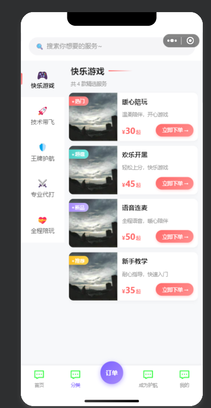
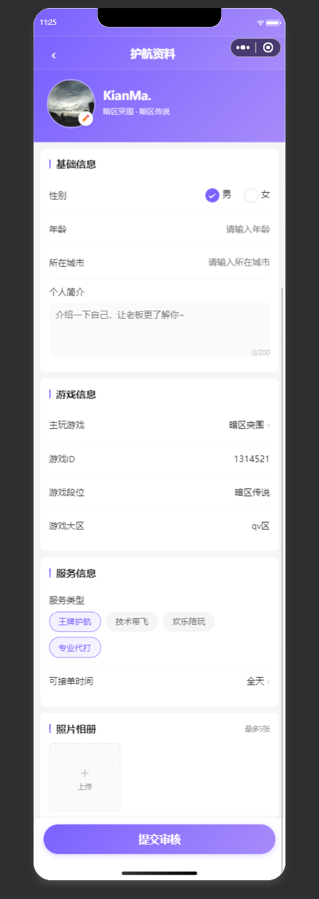
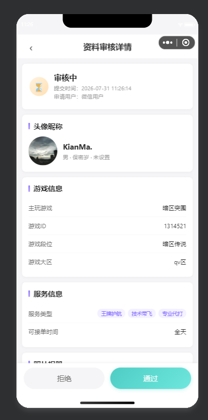
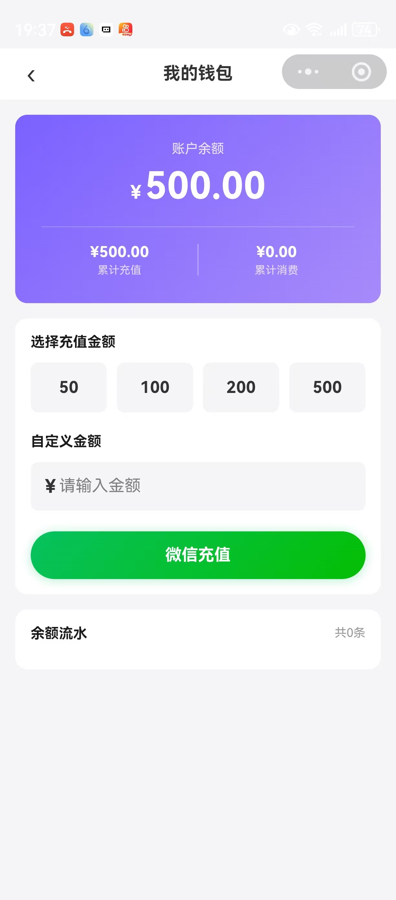
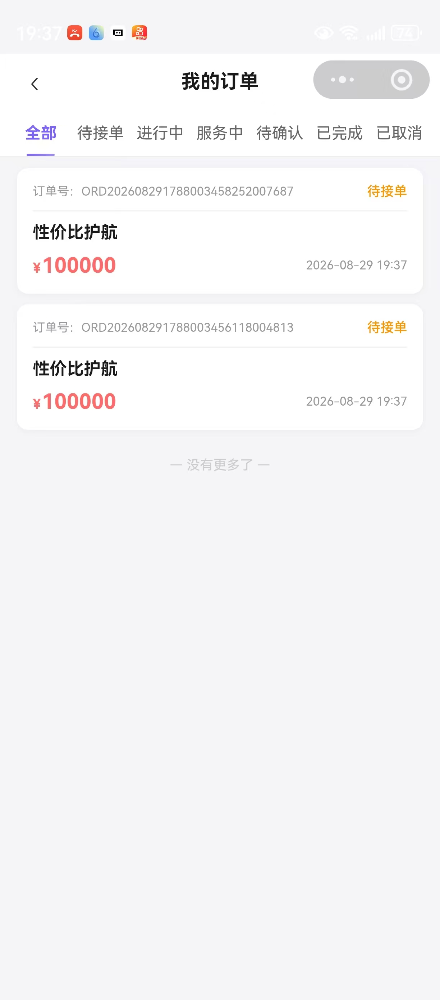
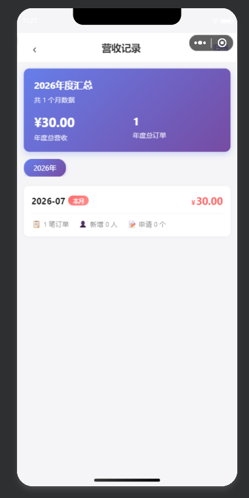
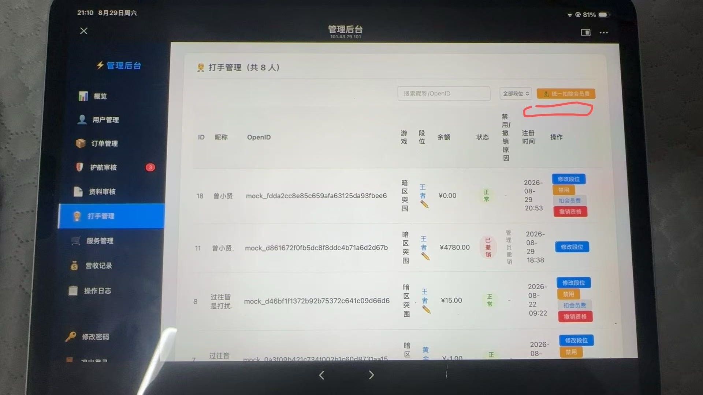

# Companion Platform 陪玩服务平台

微信小程序 + Flask 管理后端的陪玩服务撮合平台：用户端小程序下单约伴，陪伴师端接单管理，管理后台处理财务、审核与运营，接入微信支付完成真实交易闭环。已上线运营。

## 界面预览

| 服务分类页 | 陪伴师资料 | 资料审核 |
|---|---|---|
|  |  |  |

| 钱包充值 | 订单列表 | 营收统计 | 管理后台 |
|---|---|---|---|
|  |  |  |  |

## 功能模块

**小程序端（36+ 页面）**
- 双角色体系：用户下单 / 陪伴师接单，完整订单状态机流转
- 微信支付 v2：签名验证、统一下单、支付回调验签、退款
- 虚拟币钱包：充值、消费、佣金分成结算（数据库防重机制，杜绝重复入账）
- 陪伴师入驻申请与资质管理、服务管理、评价体系

**管理后台（Flask，13 个业务模块）**
- 订单管理 · 财务对账 · 提现审核 · 佣金结算
- 用户与陪伴师管理 · 入驻审核 · 公告管理
- 文件上传 · 数据看板

## 项目结构

```
├── app.js / app.json          # 小程序入口与全局配置
├── pages/                     # 36+ 小程序页面
├── components/                # 公共组件
├── custom-tab-bar/            # 自定义底部导航
├── admin-backend/             # Flask 管理后端
│   ├── app.py                 # 应用入口
│   ├── config.py              # 配置中心（密钥全部走环境变量）
│   ├── database.py / models   # 数据层
│   ├── routes/                # 13 个业务路由模块
│   │   ├── pay.py             # 微信支付（下单/回调/退款）
│   │   ├── wallet.py          # 虚拟币钱包
│   │   ├── escort_order.py    # 陪伴师订单
│   │   ├── escort_finance.py  # 财务结算
│   │   └── ...
│   └── tasks.py               # 异步任务
└── images/                    # 静态资源
```

## 技术栈

微信小程序原生开发 · Flask · MySQL（连接池）· 微信支付 API v2 · gunicorn 多进程部署

## 工程实践亮点

- **资金安全**：支付回调验签 + 幂等处理，佣金结算防重（避免重复入账）
- **订单状态机**：下单 → 支付 → 接单 → 完成 → 评价 全链路状态流转，非法状态迁移拦截
- **配置安全**：AppSecret / 商户密钥等全部通过环境变量注入，仓库不含真实密钥
- **登录模式可切换**：mock / 真实微信登录（LOGIN_MODE），支付同样支持 mock 联调

## 快速开始

```bash
cd admin-backend
pip install -r requirements.txt
cp .env.example .env   # 填入 AppID / AppSecret / 商户号等
python app.py          # 开发模式
gunicorn -w 4 app:app  # 生产部署
```

小程序端用微信开发者工具打开项目根目录即可（`project.config.json` 中替换为你自己的 AppID）。

## 说明

- 原始项目名 escort operation，上线运营版本
- 商户密钥、证书等敏感信息不在此仓库中，部署前需自行在 `.env` 配置
